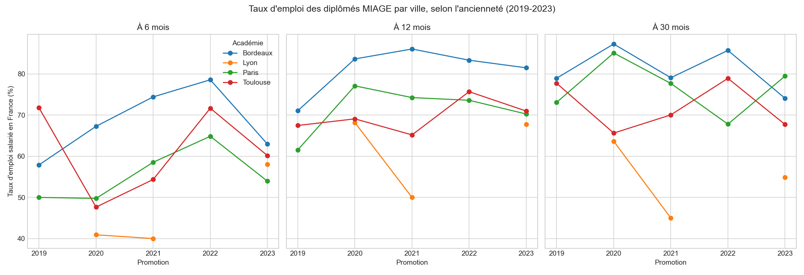
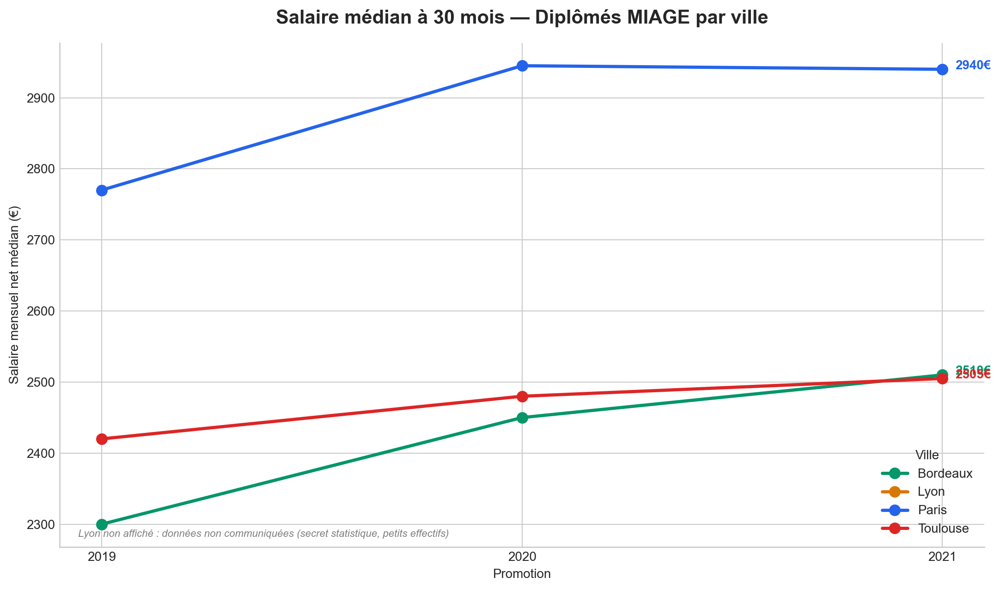
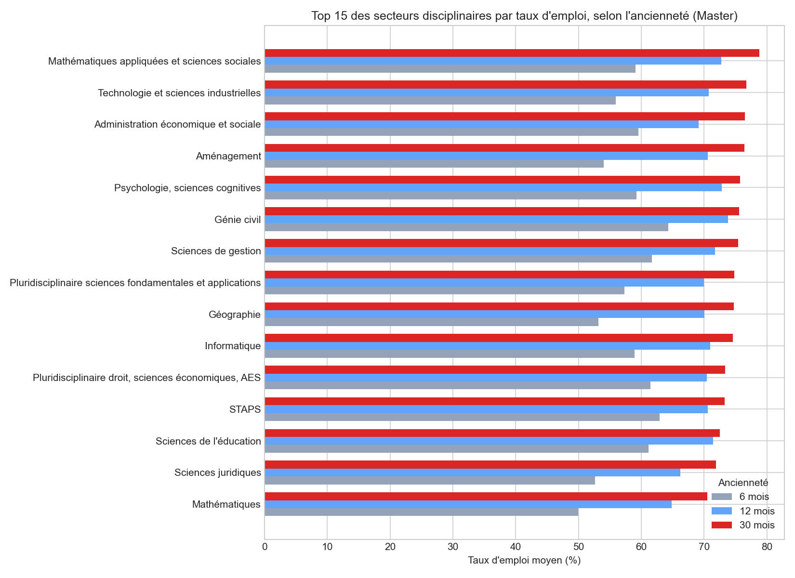
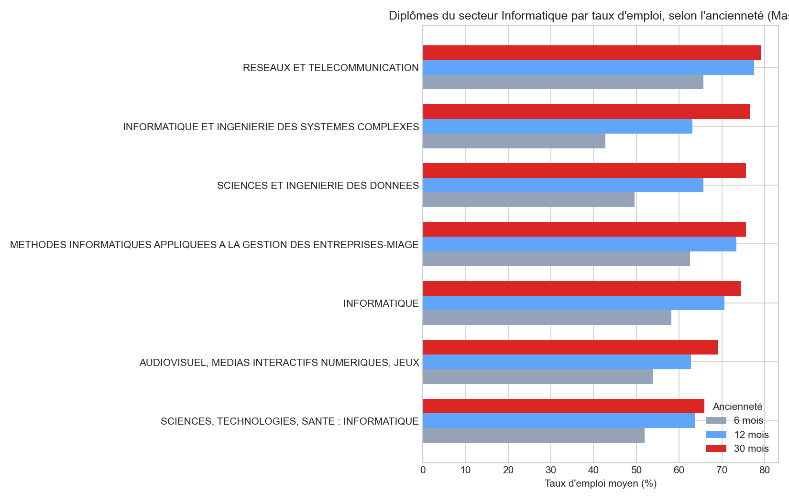

# Insertion professionnelle des diplômés MIAGE en France

Étudiant en L3 MIASHS (Réseau MIAGE) à l'Université Toulouse III Paul Sabatier,
je me suis demandé si mon choix de filière et de ville était pertinent en
termes de débouchés professionnels. Ce projet répond à trois questions à
partir des données officielles du ministère de l'Enseignement supérieur.

## Questions posées

1. Les diplômés MIAGE de Toulouse s'insèrent-ils aussi bien qu'ailleurs
   (Paris, Lyon, Bordeaux) ?
2. Comment l'Informatique se positionne-t-elle parmi les autres secteurs
   disciplinaires en France ?
3. Au sein même de l'Informatique, la MIAGE est-elle un bon choix par
   rapport aux autres diplômes ?

## Source des données

[Insertion professionnelle des diplômés](https://data.esr.gouv.fr) —
data.esr.gouv.fr. ~1 million de lignes, données 2019-2024, niveau Master.

## Méthodologie

- Filtrage sur les diplômés uniquement (exclusion des sortants non diplômés)
- Agrégation par ville/promotion (plusieurs universités par ville dans
  certains cas)
- Nettoyage des valeurs "nd" (secret statistique sur petits effectifs)
- Comparaison sur trois horizons (6, 12, 30 mois après le diplôme) pour
  distinguer vitesse d'insertion et insertion durable

## Résultats

### 1. MIAGE : Toulouse vs autres villes




Toulouse se situe dans la moyenne sur le taux d'emploi. Sur le salaire en
revanche, l'écart avec Paris est net (environ 400-500€/mois), plus
probablement lié au coût de la vie et à la concentration d'entreprises en
Île-de-France qu'à une différence de qualité de formation.

### 2. L'Informatique parmi les secteurs disciplinaires



L'Informatique se classe dans le top 25% des secteurs pour le taux d'emploi,
et se distingue par un très bon salaire médian.

### 3. La MIAGE au sein de l'Informatique



La MIAGE se classe parmi les meilleurs diplômes du secteur informatique,
devant le diplôme générique "Informatique".

## Limites

- Les moyennes ne sont pas pondérées par l'effectif réel de chaque diplôme
- Certaines villes (Lyon) reposent sur de petits échantillons, à
  interpréter avec prudence
- Données jusqu'à 30 mois post-diplôme uniquement pour les promotions
  2019-2023

## Conclusion

Choisir la MIAGE, c'est choisir une filière du secteur informatique — déjà
favorisé en France — qui performe mieux que la moyenne des diplômes
d'informatique eux-mêmes. Le choix de la ville influe surtout sur le
salaire, moins sur les chances d'obtenir un emploi.

## Utilisation

```bash
pip install -r requirements.txt
python exploration.py
```

Le fichier de données (`fr-esr-insersup.csv`) doit être placé à la racine
du projet. Il est disponible sur
[data.esr.gouv.fr](https://data.esr.gouv.fr).
